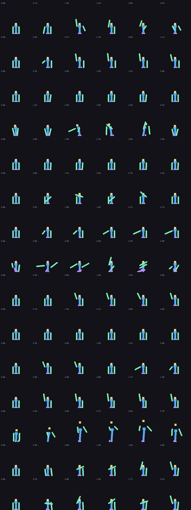

# Emotecraft → Minecraft Bedrock Edition

This repository now contains a **fully working Bedrock Edition port** of the
Emotecraft Fabric mod for Minecraft Java 26.3.

* Original artifacts (unchanged): `emotecraft-for-MC26.3-3.5.0-b.build.179.jar`
  and `PlayerAnimationLibMerged-1.2.9+mc.26.3.jar`.
* The port lives in [`bedrock/`](bedrock/README.md).
* Installable add-on: **`bedrock/dist/Emotecraft-Bedrock.mcaddon`** — double
  click it, then activate it (behaviour + resource pack) in your world.

### What works

| Emotecraft feature | Bedrock port |
|---|---|
| 14 bundled emotes with pose animation | ✅ converted to real Bedrock bone animations |
| Emote menu / wheel with favourites | ✅ `/emote`, Emote Wheel item, sneak-use to edit |
| Emote library + search | ✅ `/emotes`, `/emote list`, searchable screens |
| Emote icons + author + description | ✅ original icons and metadata |
| Emote music (Caramell, Let's Groove, Take The L) | ✅ transcoded Opus → Ogg Vorbis |
| Per-player config (enabled, HUD, announcements, volume, cooldown) | ✅ `/emote config` |
| Custom emotes (drop in a `.json`) | ✅ `bedrock/custom/` → `npm run build` |
| Commands / integrations | ✅ `/emote <name>`, `/scriptevent emotecraft_play <id>` |
| Other players see emotes | ✅ client-side animation, everyone with the pack |

Known platform limits (Bedrock, not the port): first-person arms are not
animated, emotes cannot move the player (no root motion), and players need the
add-on installed to see the animations. Full details in
[`bedrock/README.md`](bedrock/README.md).

### Quick start

```bash
cd bedrock
npm run build     # regenerate assets from the jar, bundle scripts, zip the add-on
npm run verify    # offline test suite (runs the built bundle against a mock engine)
```



## Licence

Upstream Emotecraft is GPL-3.0; this port is GPL-3.0 as well. Emote designs and
audio belong to their original authors (credited in-game per emote).
