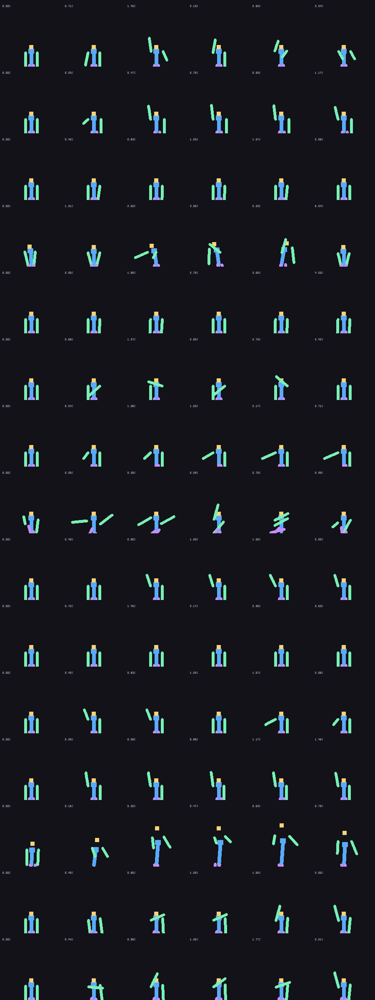

# Emotecraft for Bedrock Edition

A working port of the [Emotecraft](https://github.com/KosmX/emotes) Java/Fabric mod
(`emotecraft-for-MC26.3-3.5.0`) to **Minecraft Bedrock Edition**, as a normal
add-on: behaviour pack + resource pack, no server software, no Java, no mods
required on the client.

Every emote that ships with the Java mod is converted to real Bedrock bone
animations, so other players see you emote with no extra setup.

| | |
|---|---|
| **Install** | `bedrock/dist/Emotecraft-Bedrock.mcaddon` (double click) |
| **Works on** | Bedrock 1.21.90+ (Windows, Android, iOS, consoles with add-ons enabled) |
| **Emotes** | 14 converted + unlimited custom |
| **Audio** | 3 emotes with music, transcoded to Ogg Vorbis |
| **Scripts** | `@minecraft/server` 2.x + `@minecraft/server-ui` 2.x |



---

## What you get

- **Emote wheel** – `/emote` opens a wheel with your favourite emotes, one tap to play.
- **Emote library** – `/emotes` browses and searches every emote, with icons,
  author, length and loop/audio tags.
- **Emote Wheel item** – right click to open the wheel anywhere; craftable from
  4 paper + 1 book, or `/emotewheel`.
- **All 14 bundled emotes**: Back Flip, Caramell Dance, Clap, Club Penguin,
  Crying, Over Here, Kazotsky Kick, Let's Groove, Face Palm, Point,
  Roblox Potion Dance, Take The L, Twerk, Waving.
- **Music** for Caramell Dance, Let's Groove and Take The L.
- **Per-player options** (`/emote config`): enable/disable emotes, chat
  announcements, on-screen toast, wheel, volume, cooldown.
- **Custom emotes** – drop any Emotecraft `.json` into `bedrock/custom/` and
  rebuild; it becomes a first-class emote with icon and audio.
- **Command block / NPC support** – `/scriptevent emotecraft_play <id>`
  (also `emotecraft:play`, `emotecraft_stop`, `emotecraft_wheel`).

| Command | What it does |
|---|---|
| `/emote` | open the emote wheel |
| `/emote <name or id>` | play an emote (`/emote wave`, `/emote twerk`) |
| `/emote stop` | cancel your current emote |
| `/emote list` | open the emote library |
| `/emote config` | per-player options |
| `/emote help` | in-game help screen |
| `/emotes` | open the emote library |
| `/stopemote` | cancel your current emote |
| `/emotewheel` | give yourself the Emote Wheel item |

---

## Installing

1. Download `bedrock/dist/Emotecraft-Bedrock.mcaddon`.
2. Double click it (Windows/Android) or import it (iOS: share → Minecraft).
3. Create or edit a world → **Add-Ons** → activate **Emotecraft** for both
   behaviour and resource packs.
4. Enable **Beta APIs** in the world's Experiments if your version still asks
   for it (needed for custom commands / `@minecraft/server` 2.x).
5. Join, then type `/emote`.

`Emotecraft-RP.mcpack` and `Emotecraft-BP.mcpack` are also provided for servers
that distribute packs manually (e.g. a `resource_packs` + `behavior_packs`
folder on BDS); use both together.

> **Want other players to see emotes?** They need the add-on active too. This is
> a limitation of Bedrock: custom animations are client-side resource-pack data.

---

## Building

```bash
cd bedrock
npm run build      # convert emotes from the jar + bundle scripts + zip add-on
npm run verify     # offline test-suite (mocked Bedrock runtime)
```

`npm run build` needs nothing but Node.js. It reads the emote data straight out of
`emotecraft-for-MC26.3-3.5.0-b.build.179.jar` in the repository root.

Audio conversion (Ogg **Opus** → Ogg **Vorbis**, the only Ogg codec Bedrock
decodes) needs Python with `soundfile`:

```bash
python3 -m venv .venv && .venv/bin/pip install soundfile numpy
EMOTECRAFT_PYTHON=.venv/bin/python npm run build
```

Already-converted `.ogg` files are never overwritten, so `npm run build` works
without Python once the repository has the audio committed.

Other commands:

```bash
npm run convert                     # only regenerate assets from the jar
node tools/build.js --no-convert    # repackage without re-converting emotes
node tools/preview.js               # render docs/preview-*.png pose sheets
node tools/verify.js                # run the checks
```

### Layout

```
bedrock/
├─ src/BP/                 behaviour pack
│  ├─ manifest.json
│  ├─ recipes/             Emote Wheel crafting recipe
│  └─ scripts/
│     ├─ index.js          commands, item, events, bootstrap
│     ├─ core/catalogue.js emote catalogue + fuzzy search
│     ├─ core/emoteManager.js  playback, looping, audio, cooldown
│     ├─ core/settings.js  per-player options (dynamic properties)
│     ├─ ui/forms.js       wheel, library, details, config screens
│     └─ data/emotes.js    generated catalogue
├─ src/RP/                 resource pack
│  ├─ animations/emotes/   20 fps Bedrock bone animations
│  ├─ textures/            emote icons + item texture
│  ├─ sounds/              Ogg Vorbis + sound_definitions.json
│  ├─ items/               Emote Wheel item definition
│  └─ texts/
├─ custom/                 drop your own Emotecraft .json files here
├─ tools/                  convert.js, build.js, verify.js, preview.js
└─ dist/                   built .mcaddon / .mcpack files
```

---

## Custom emotes

1. Put your file in `bedrock/custom/`, e.g. `custom/dab.json`.
   Optional: `custom/dab.png` (256×256 icon) and `custom/dab.ogg` (audio).
2. `cd bedrock && npm run build`
3. Re-import the `.mcaddon` (or copy the packs into your world).

Both Emotecraft JSON schemas are supported:

- **legacy** `{"emote": {"moves": [...]}}` – positions are absolute model-part
  pixels, `degrees: false` means radians (the default for community emotes);
- **PlayerAnimationLibrary / Blender export**
  `{"animations": {"id": {"bones": {...}}}}` – degrees, positions are offsets,
  which is what Emotecraft 3.x itself ships.

The converter bakes either one into keyframe tracks, resamples at 20 fps, and
writes a Bedrock animation. Emotecraft's `beginTick` / `returnTick` / `stopTick`
semantics are preserved: looping emotes get an extra `_loop` clip that replays
the `returnTick → endTick` window forever, one-shots settle back to the rest pose.

---

## How the port works

Bedrock and Java both animate the player rig with the same right-handed model
space, so the conversion is mostly a re-encoding:

| Emotecraft | Bedrock |
|---|---|
| `pitch`, `yaw`, `roll` (radians or degrees) | bone `rotation: [x, y, z]` (degrees) |
| part `x/y/z` in pixels | bone `position` in blocks (`px / 16`) |
| `easeBeforeKeyframe`, easings | sampled and baked at 20 fps |
| `torso` | bone `body` |
| `body` | bone `waist` |
| `leftArm` / `rightArm` / `leftLeg` / `rightLeg` / `head` / `cape` | same names |

Emotecraft's own Geyser bridge (`GeyserAnimationController#updateBone`) forwards
these axes unchanged to Bedrock, which is the reference this port follows.

Playback uses `player.playAnimation("animation.emotecraft.<id>")`, so the motion
is rendered client-side by the resource pack and every player with the pack sees
it. `override_previous_animation` makes the emote replace the vanilla walk /
look-at poses, exactly like the Java mod's `ModelPart` overrides.

Verified behaviour is covered by `npm run verify`, which executes the built
bundle against a mocked `@minecraft/server`: command registration, `/emote`
dispatch, unknown emote handling, wheel forms, item use, scriptevents and the
first-join message. `node tools/preview.js` renders the generated animation data
through the vanilla skeleton into `docs/preview-*.png`.

---

## Limitations (Bedrock platform, not the port)

- Players must have the add-on installed to see emotes.
- First-person arm motion is not animated (Bedrock does not expose the
  first-person rig to animations the way Java does).
- Emotes cannot move the player (no root motion), so a "back flip" rotates the
  body rather than travelling.
- A few of Emotecraft's bone-bending ("bend") channels have no Bedrock
  equivalent and are ignored.

## Credits & licence

- Emote data, icons and audio: the **Emotecraft** project
  (KosmX, dima_dencep, Kale Ko, ZigyTheBird) – GPL-3.0.
- This Bedrock port: GPL-3.0, same as upstream.
- Emote animations are converted from the original files; the emote designs
  belong to their authors (credited in-game per emote).
